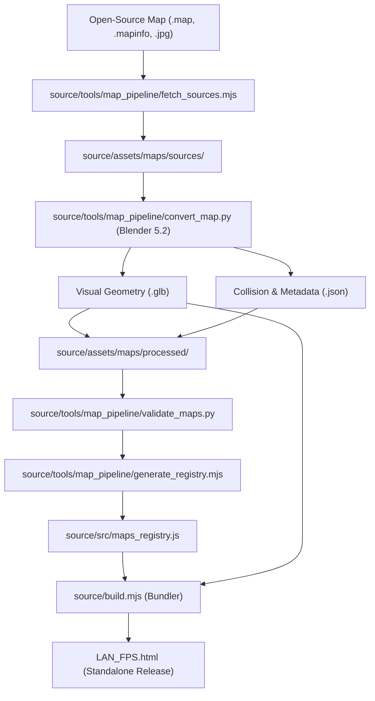

# OPERATION: MAPFORGE — Map Conversion & Import Pipeline

This document describes the reproducible level import, conversion, optimization, and packaging pipeline built for **LAN_FPS**.

---

## 1. Pipeline Architecture



---

## 2. Directory Layout

```text
source/
├── assets/
│   └── maps/
│       ├── sources/        # Raw upstream source files (*.map, *.mapinfo, *.jpg)
│       │   ├── boil.map
│       │   ├── glowplant.map
│       │   └── dance.map
│       ├── staging/        # Intermediate geometry and texture working cache
│       ├── processed/      # Production runtime assets (*.glb, *.json, *.jpg)
│       │   ├── foundry.glb
│       │   ├── foundry.json
│       │   ├── glowplant.glb
│       │   ├── glowplant.json
│       │   ├── zenith.glb
│       │   └── zenith.json
│       └── licenses/       # Upstream license texts and attribution notes
│
├── tools/
│   └── map_pipeline/
│       ├── fetch_sources.mjs      # Fetches map files from Xonotic/OpenArena/RedEclipse
│       ├── convert_map.py         # Headless Blender 5.2 Quake parser & GLB/AABB exporter
│       ├── validate_maps.py       # Validates spawns, clearance, and AABB consistency
│       └── generate_registry.mjs  # Generates source/src/maps_registry.js
│
└── src/
    ├── maps_registry.js    # In-memory map metadata and collision database
    ├── arena.js            # getMap() factory & surface audio resolvers
    └── render.js           # GLTF loader & Three.js visual scene assembly
```

---

## 3. Step-by-Step Conversion Workflow

### Step 1: Source Acquisition
Run the automated downloader to fetch map geometry and metadata:
```bash
node source/tools/map_pipeline/fetch_sources.mjs
```

### Step 2: Blender Headless Conversion
Execute the automated Quake brush solver and GLB exporter using Blender 5.2:
```bash
& "C:\Program Files\Blender Foundation\Blender 5.2\blender.exe" -b --python source/tools/map_pipeline/convert_map.py -- foundry glowplant zenith
```
This script:
1. Solves all convex polyhedra plane triplets ($N \cdot X = D$).
2. Converts Quake coordinate space ($X \to x$, $Z \to y$, $Y \to -z$) at standard scale ($1\,\text{m} = 32\,\text{units}$).
3. Grounds the lowest playable level at $Y = 0.00\,\text{m}$ and centers the map around $(0, 0)$.
4. Extracts player spawns (`info_player_*`), jump pads (`trigger_push`), and hazard kill floors (`killY`).
5. Generates optimized PBR industrial materials (`Mat_Floor`, `Mat_Wall`, `Mat_Trim`, `Mat_Hazard`).
6. Welds duplicate vertices (`threshold=0.005`) and exports visual `.glb` and collision `.json`.

### Step 3: Geometry & Spawn Validation
Validate that no spawn point intersects world collision geometry and all floors are continuous:
```bash
python source/tools/map_pipeline/validate_maps.py
```

### Step 4: Registry Generation
Compile the processed metadata and AABB boxes into `maps_registry.js`:
```bash
node source/tools/map_pipeline/generate_registry.mjs
```

### Step 5: Test & Build Standalone HTML
```bash
cd source
npm test
npm run build
```

---

## 4. Coordinate & Physics Standards

| Dimension / Property | Engine Value | Quake Source Equivalent |
|---|---|---|
| Scale Factor | `0.03125` | $1\,\text{m} = 32\,\text{Quake Units}$ |
| Coordinate Mapping | $(x, y, z) = (X \cdot s, Z \cdot s, -Y \cdot s)$ | $X \to x$, $Z \to \text{Up}$, $Y \to \text{North}$ |
| Player Height | $1.80\,\text{m}$ (standing), $1.15\,\text{m}$ (crouch) | $56 - 64\,\text{units}$ |
| Step Climb Height | $0.55\,\text{m}$ | Smooth traversal up curbs, ramps, stairs |
| Max Jump Height | $1.30\,\text{m}$ ($v_y = 7.2\,\text{m/s}$) | $42\,\text{units}$ |
| Jump Pad Impulse | $14.5 - 16.0\,\text{m/s}$ | Launches player to upper catwalk tiers |
