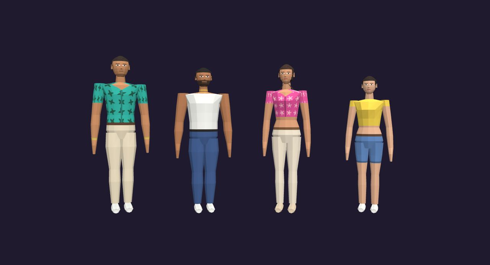
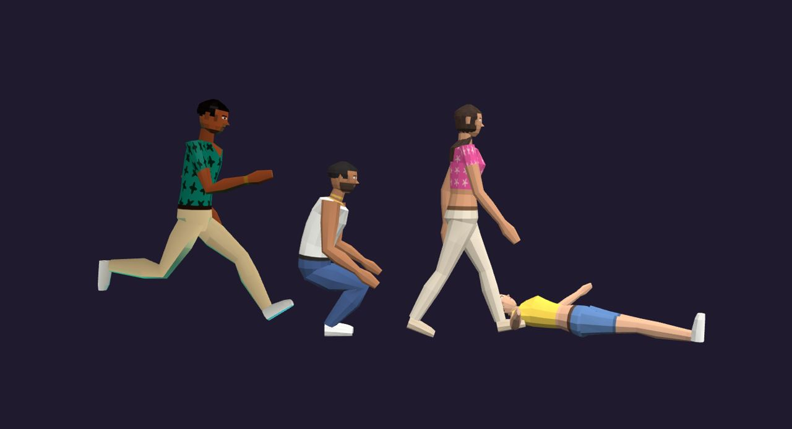
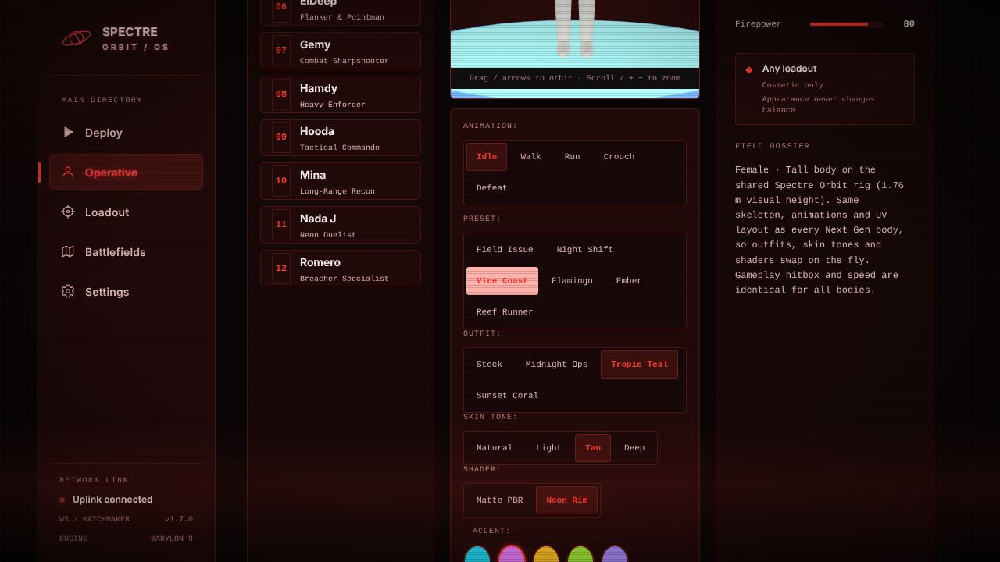
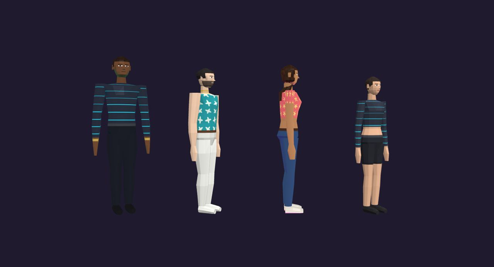
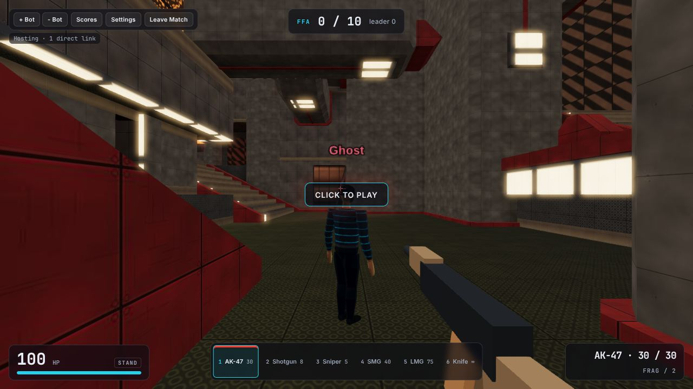
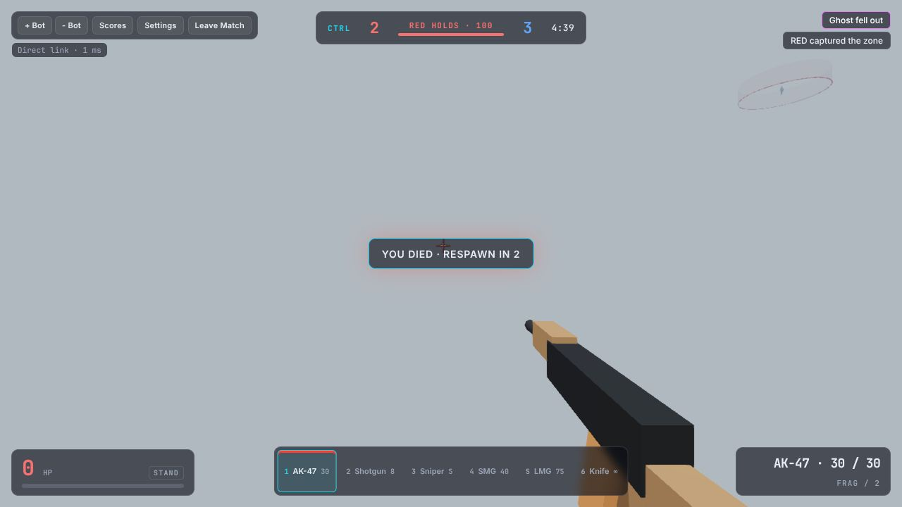
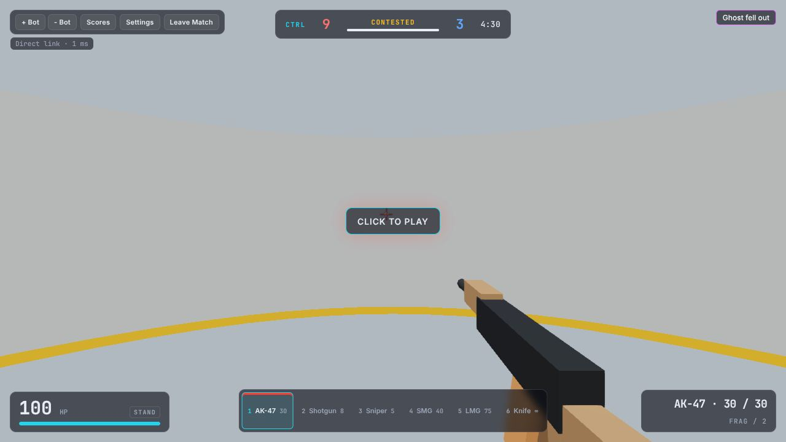
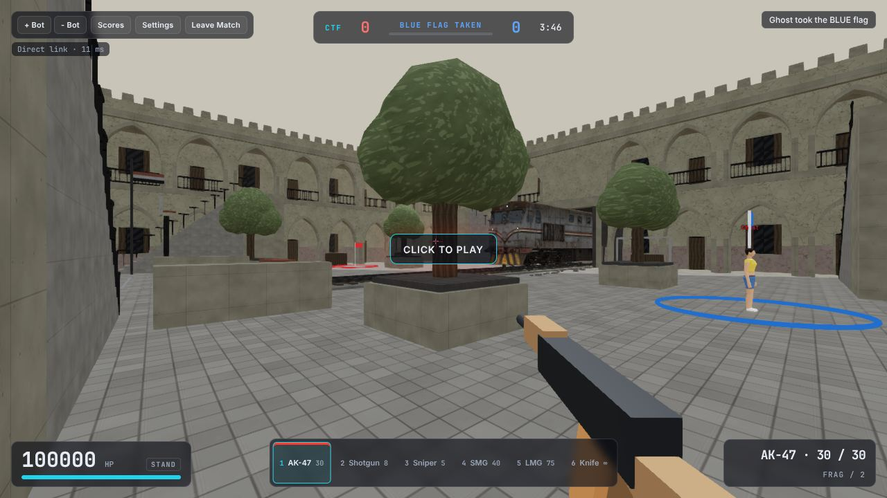

# Spectre Orbit Next Gen: online edition upgrade

This upgrade covers the Babylon.js online edition only (`Spectre_Orbit_Light.html`). Classic still runs offline, and its committed HTML (`Spectre_Orbit_Classic.html`, `LAN_FPS.html`) is not regenerated by this branch.

- Branch: `feat/spectre-orbit-next-gen`
- Baseline: `main` at `d488ac1`, v1.7.0
- Brief: `next_gen_info/Spectre_Orbit_Claude_Implementation_Brief.md`

## What players can do

1. **Choose one of four new bodies** under Operative. All four are generated in code, and none is derived from a legacy GLB (including Nada J).

   | ID | Name | Archetype | Visual height |
   | --- | --- | --- | --- |
   | `ng-male-tall` | Rico | Male · Tall | 1.86 m |
   | `ng-male-short` | Dante | Male · Short | 1.72 m |
   | `ng-female-tall` | Lucia | Female · Tall | 1.76 m |
   | `ng-female-short` | Nina | Female · Short | 1.62 m |

   
   

2. **Customise the look in the creator.** Pick a preset (6) or set each part yourself:
   - outfit surface: Stock, Midnight Ops, Tropic Teal, Sunset Coral
   - skin tone: Natural, Light, Tan, Deep
   - shader: Matte PBR or Neon Rim
   - accent colour (5)

   The turntable previews changes live. **Save & Equip** keeps them; **Default look** and **Revert to saved** undo them.
    

3. **Join a match and look the same to everyone.** The host validates each look and sends it in every snapshot, so late joiners and respawns see it too.
   

4. **Play Control or Capture the Flag**, alongside FFA, TDM and Gun Game, with a new combat HUD that shows mode, score and objective at the top centre.
     

## Characters and the creator

### Rig and topology
`source/tools/build_ng_characters.mjs` (`npm --prefix source run build:characters`) builds all four bodies from one list of parts. They share:

- **Joints.** The 17 joints the legacy roster uses (`Hips, Spine, Chest, Neck, Head, UpperArm/Forearm/Hand.L/R, UpperLeg/LowerLeg/Foot.L/R`), with identity rest rotations. They share the joint names, so they also work with the existing avatar code.
- **Animation clips.** `idle, walk, run, crouch, crouch_walk, die, death`, generated procedurally.
- **Topology.** 1,075 flat-shaded triangles each; Lucia's long hair adds 40.
- **UV layout.** One authored layout, `NG_UV` in `source/src/ng_bodies.js`. Every part unwraps cylindrically, with the front of the body at the centre of its region.

The generator is deterministic, and a test checks that the committed GLBs match it byte for byte. After changing `ng_bodies.js` or the generator, run `build:characters` and commit the new GLBs.

**About the four bodies:** these are code-authored low-poly bodies in the style of reference 02 (faceted, tropical retro-futurist). Each archetype has its own proportions: shoulder, chest, waist and hip widths, bust and glute shaping, limb thickness, and hair style. That is real geometry, not uniform scaling. They are not sculpted production models, and faces are painted onto the texture rather than modelled.

### Appearance data
`AppearanceV1` is `{ v: 1, bodyId, outfitId, skinId, shaderId, accentId }`.

- Only catalog IDs are accepted. Unknown values, URLs and shader source fall back to defaults.
- On the network the cosmetic part travels as a short code: `outfit.skin.shader.accent`, for example `tropic.tan.rim.magenta`.
- Saved looks live in `localStorage` under `lanfps.look.v1`. Corrupt or unavailable storage falls back to the default look.
- The body is the existing `char` field (`lanfps.char`), so legacy saves still load. New players default to `ng-male-tall`.

### How a look gets to other players
1. **Guest sends it.** After the WebRTC link opens, the guest sends `{t:'look', lk}`. The host player's own look goes straight into `addPlayer`.
2. **Host validates it.** `HostGame.setLook` canonicalises the look with `canonicalLook`. It rejects payloads over 512 bytes and allows at most 2 changes per second per player.
3. **Snapshots carry it.** Each snapshot entry includes `lk`, which covers late join, respawn and reconnect. Teams are still assigned by the host.
4. **The client applies it.** `BabylonAvatar.setLook` calls `applyAppearance`, the same resolver the lobby portrait and the turntable use.

### Materials and textures
`source/src/babylon/appearance_materials.js` handles this:

- **Next Gen bodies** get an exact repaint: `paintNgAtlas(body, look)` uses the authored regions, so skin, hair, eyes, clothes and shoes never bleed into each other.
- **Legacy roster GLBs** (Tripo bakes with no masks) get a per-pixel colour classifier. Warm mid-saturation pixels count as skin, and very dark or near-white pixels are kept. This is a heuristic and can misclassify tan or brown clothing.
- **Caching.** Variant atlases are cached per scene and shared between avatars. Each avatar owns its own materials and disposes them; it never disposes shared textures.
- **Swaps.** Changing a look never reloads the GLB and never touches the skeleton or animation state.
- **GLB loading.** Each GLB is decoded once per scene into an `AssetContainer`, then instantiated per avatar.
- **Neon Rim** is a `StandardMaterial` with a fresnel emissive rim in the accent colour. In team modes the rim uses the team colour.

## Modes
`source/src/modes.js` holds a single `MODE_CATALOG`. The lobby selector lists only modes marked `ready`, each with a short briefing.

| Mode | Rules |
| --- | --- |
| FFA | Unchanged: 10 kills wins. |
| TDM | Unchanged: 25 team kills wins, no friendly fire, auto-balanced teams. |
| Gun Game | Unchanged and verified: AK-47 → SMG → LMG → Shotgun → Sniper → Knife. The host forces the ladder weapon and the client blocks manual switching. A knife kill on the last rung wins. |
| Control | 6 m zone on the spawn closest to the map's centre. Only living players inside count. One team alone captures in 5 s; on an enemy-owned zone it first neutralises (5 s), then captures (5 s). Both teams inside freezes everything (Contested). The owner scores 1 point/s while it holds the zone alone. An empty zone keeps its owner and progress but doesn't score. 100 points or 5 minutes wins; level scores at time are a Draw. No overtime. The round resolves once, then the usual 8 s pause and a full reset. Scoring needs at least one player on each team (bots count). **Bots fight but don't play the objective.** |

| Capture the Flag | Only offered on maps with red and blue team spawns: **Zenith, Rail Yard, Schoolyard**. On other maps the selector hides it, and the host refuses to start with a readable error. Each base sits on the team spawn nearest that team's spawn centroid. Touch the enemy flag (1.5 m) to carry it; a player carries at most one flag, with no speed change. You score by reaching your own base (2 m) while your own flag is home. Death or disconnect drops the flag at the carrier's last grounded position, and falling into the void returns it home. A teammate's touch returns a dropped flag, and it returns on its own after 15 s. A capture resets that flag. 3 captures or 5 minutes wins; level at time is a Draw. Each tick resolves in a stable order: carrier/drop → touches (sorted by player ID) → captures. **Bots fight but don't run flags.** |

Team checks now go through `isTeamMode`, so friendly fire, balancing, spawns and bot targeting all apply to Control. The Control and CTF rules (`source/src/objectives.js`) are pure functions counted in host ticks, and their state is part of each snapshot (`obj`). Flags and base rings render in the Babylon view.

## Combat HUD
`source/hud_online.css` and `source/src/hud_online.js` are included only in the online build:

- **Top centre:** mode, team scores or progress, Control state (neutral / capturing % / holds / contested) or CTF flag state (home / taken / dropped with countdown), and the remaining time.
- **Top left:** match controls, with connection status underneath.
- **Top right:** kill feed, limited to 4 rows.
- **Bottom left:** health with a bar, plus stance.
- **Bottom right:** weapon, ammo, reload state and grenades.
- **Bottom centre:** weapon slots.

The objective panel's DOM is built once per mode; per-frame updates only change text and widths. This also fixes a bug where the shared stylesheets stretched the vitals panel to full screen height.

## Bugs fixed along the way
- **A first-time guest never rendered the 3D view.** `GuestSession` was created before the `View` existed, so `client.view` was `null`.
- **Guests could play on different collision than the host.** They built the default `forest` map; `init` only copied `mode`, not `map`/`seed`. The guest now waits for `init` (10 s timeout with a readable error) before building the world.
- **Remote avatars never played animations.** `instantiateModelsToScene` renamed the animation groups (`idle` became `idle_x7ab`), so clip lookups failed.

## Tests (run in the cloud session on Node 22.23.4 with headless Chromium on SwiftShader)

| Command | Result |
| --- | --- |
| `npm --prefix source ci` / `npm --prefix server ci` | ok |
| `npm --prefix source run test:all` | pass: 44 shared, networking, Babylon, session, **13 appearance**, **17 modes** |
| `npm --prefix server test` | pass (4) |
| `npm --prefix source run build:online` | ok, 44.15 MB (baseline 42.76 MB; +1.4 MB for the four GLBs) |
| `npm --prefix source run build` + `test:ui` (Classic) | ok; Classic output restored, not committed |
| `node source/test/online_upgrade_browser.mjs` | pass. Two real browsers over WebRTC on localhost: creator save, host and guest see each other's body and look, a third client joins late and sees both, leaving cleans up the avatar. |
| `node source/test/online_modes_browser.mjs` | pass. Two real browsers in Control: teams red/blue, the host captures and the guest HUD agrees, contested freezes scoring, the round ends at 100, then a clean restart after 8 s. CTF on Schoolyard: the selector depends on the map, the guest builds the host's map, flag take shows on the guest HUD, and exactly one capture is scored with both flags back home. |

Both browser scripts write screenshots to `dist/test-shots/`. They take Playwright from the local or global npm install, and accept `CHROMIUM_PATH` and `OUT_DIR`.

## Not done / unverified
- **Orbit Crown tiny-planet map:** not implemented.
- **Radial-gravity planet traversal:** not attempted.
- **Objective AI for bots:** bots only fight.
- **Real GPU / WebGPU rendering:** the cloud only had software WebGL. Check the creator and the Neon Rim look on real hardware.
- **Two machines on a LAN, internet/TURN, adverse-network (100 ms / 2 % loss) and six-player runs:** not run.
- **Performance:** no frame-time numbers yet (SwiftShader isn't representative).
- **Live look changes mid-match:** the creator is lobby-only. The host already accepts `{t:'look'}` at any time.

## Verify locally
```bash
npm --prefix source ci
npm --prefix server ci
npm --prefix source run test:all
npm --prefix server test
npm --prefix source run build:online
```

1. Start the matchmaker: `node server/index.mjs`. It serves `dist/online` on port 8080.
2. Open `http://localhost:8080` in two different browsers (or one normal and one private window).
3. In each one, go to **Operative**, pick a different body and preset, then **Save & Equip**.
4. In window A, open **Host**, choose **Control** and create the room. In window B, join with the room code.
5. Check that each window shows the other player's body and look, and that the HUD at the top centre tracks the zone as you stand in it (capture after 5 s, Contested when both of you are inside).
6. **LAN:** repeat step 4 across two PCs using `?server=<host-ip>:8080`.
7. **GPU:** check that Neon Rim shows a coloured edge glow and that Midnight Ops shows cyan stripes on long sleeves.

## Rollback
- **Undo the branch:** revert `feat/spectre-orbit-next-gen`, or reset `Spectre_Orbit_Light.html` to `main`. Classic artifacts were never changed.
- **Saved data:** looks are stored under their own key (`lanfps.look.v1`). Deleting that key restores the default look and leaves other settings alone.
- **Legacy characters:** a saved legacy `char` keeps working.
- **Hide the new bodies:** delete `source/assets/characters_ng/` and rebuild.
