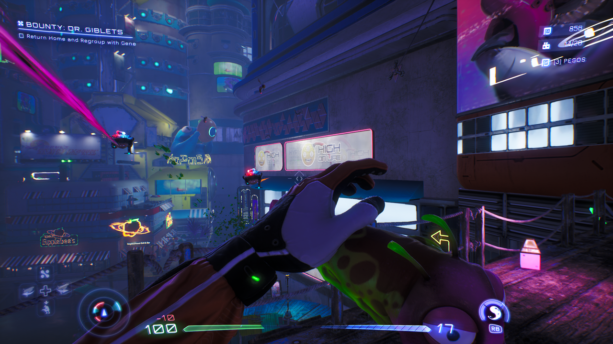
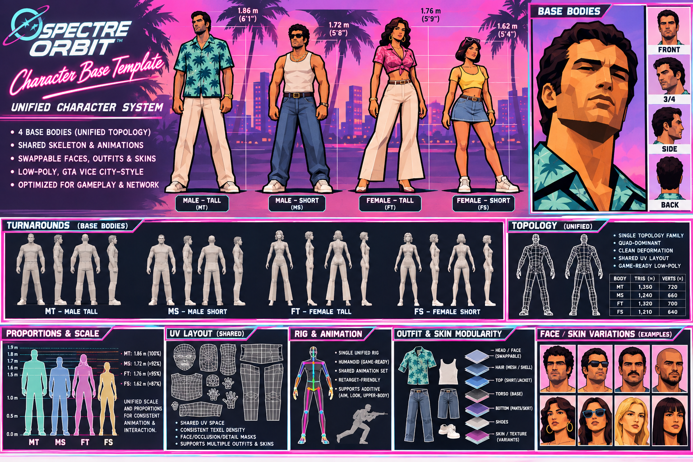
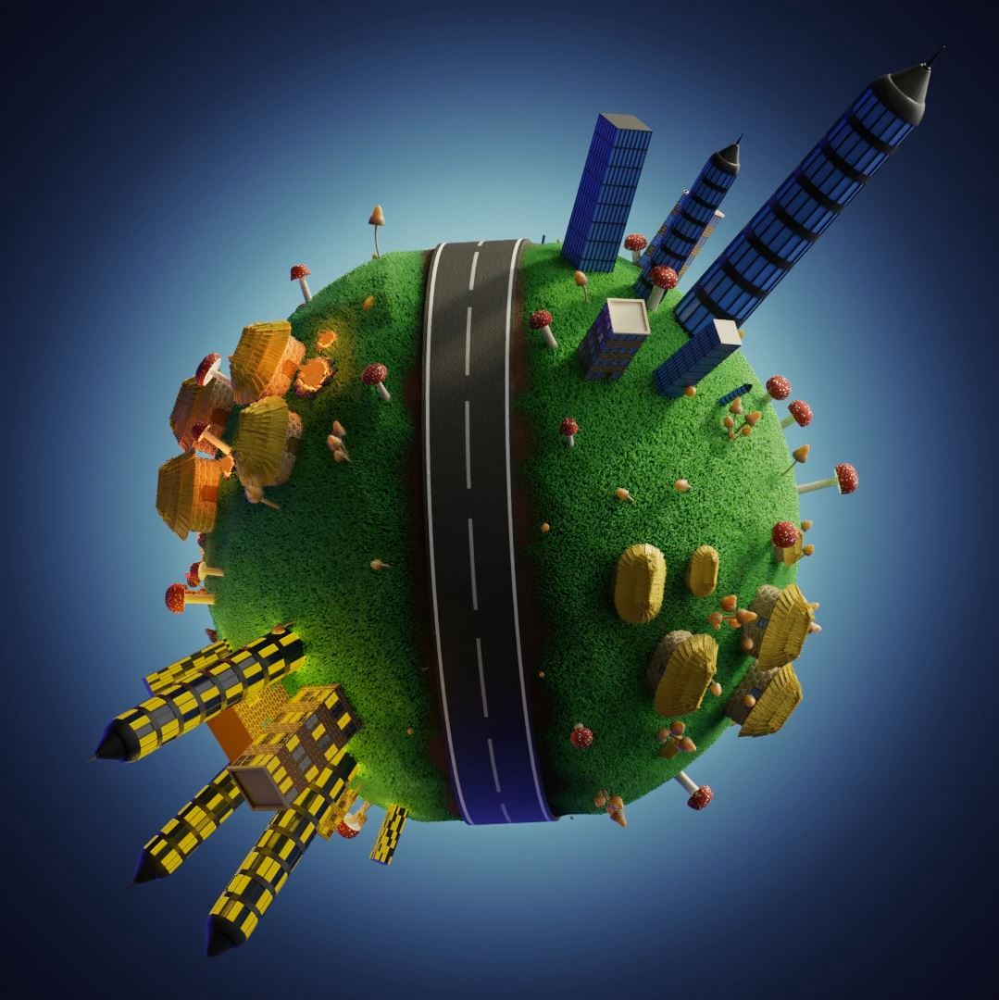
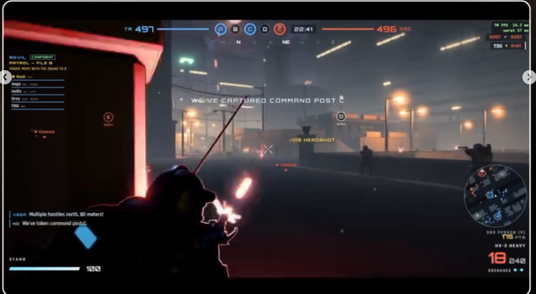

# Spectre Orbit: Babylon.js Upgrade — Claude Implementation Brief

**Deliverable:** A polished, tested upgrade of the Babylon online edition in one **8-hour / 480-minute execution session**. This document is the implementation prompt; give Claude the entire extracted package and repository checkout.

**Repository:** [abdulkarimnoah01/LAN_FPS](https://github.com/abdulkarimnoah01/LAN_FPS)  
**Inspected baseline:** `main`, commit `11db075273783d04be855a828c4b4256f5c05a0d`, inspected 5 November 2026. `version.json` says `1.7.0`. Revalidate the checkout before editing.  
**User requirements:** Unified texture/shader-swappable character creator; neat modern HUD; fun, accessible tiny-planet procedural maps; polished multiplayer; **Control, TDM, FFA, Capture the Flag, and Gun Game**. Preserve Classic.

> Claude: act as the implementation owner. Inspect, implement, run, measure, fix, and deliver working software. Do not spend this session only proposing a design. Work task-by-task using the execution tools available to you; subagents are optional only when authorized and useful. Track the checklist below. The architecture and file names marked “proposed” are design instructions, not claims about existing code. This brief is the specification and plan in one document.

## 1. Outcome, scope, and honesty

Ship a cohesive playable vertical slice with production-quality boundaries, validation, cleanup, and documentation. An eight-hour session cannot honestly promise a complete commercial release, four newly authored rigged bodies, a new spherical physics engine, and exhaustively hardened internet multiplayer. Prioritize working integration across all requested systems. State exactly what passes, what is experimental, and what remains.

The target is **all five playable modes**, a real creator whose common cosmetic changes reuse meshes/rigs, a legible HUD, and a deterministic planet-themed arena. FFA/TDM/Gun Game already have code paths; repair and reuse them. Implement compact Control and CTF rather than large objective frameworks. True walk-around spherical gravity and newly modeled anatomy are stretch goals, not prerequisites for the default slice. Do not quietly substitute a flat map or four relabeled identical bodies and claim full reference fidelity.

**Architecture:** Keep authoritative rules and deterministic world data renderer-independent. Extend the current host/client contracts additively, keep one appearance resolver for preview and gameplay, and give new objective modes a small host-owned state machine. Build the planet presentation around a connected playable crown using the existing vertical-axis simulation unless the radial-gravity gate passes.

**Stack:** Existing JavaScript ES modules, Babylon.js 9, esbuild, DOM/CSS HUD, Node.js WebSocket signaling, WebRTC gameplay channels. Use lockfiles and existing libraries. Node 22 matches current release CI; verify installed runtime.

## 2. Visual references — original files included

These are the user's five actual supplied images, copied without modification. Paths are relative to this Markdown file so the extracted ZIP remains portable. Open all five before coding; no internet is required to view them. Reference 02 is an aspirational character design sheet, not proof that compatible meshes, UVs, or rigs exist. Reference images provide visual direction, not licenses to redistribute third-party game assets or branding.

### Reference 01 — expressive sci-fi FPS presentation



Use restrained cyan/magenta accents, clear silhouettes, directional feedback, and uncluttered health/ammo hierarchy. Do not reproduce the pictured game's assets, text, or entire visual treatment. [Original image](references/reference-01.png).

### Reference 02 — unified low-poly character system



Design direction: faceted low-poly characters, tropical retro-futurist personality, four eventual body archetypes (male tall/short and female tall/short), shared animation/UV/material conventions, controllable faces/outfits/skin appearance. The image's triangle counts and heights are reference annotations, not verified repository specifications. Material changes cannot create new clothing silhouettes, facial geometry, or anatomical body types. [Original image](references/reference-02.png).

### Reference 03 — compact spherical world with a readable road loop



Use a visible planet silhouette, a strong circulation loop, distinct landmarks, and compact districts. Turn scenic density into navigable combat spaces; buildings must not consume all traversable ground. [Original image](references/reference-03.png).

### Reference 04 — district and biome organization


Use a clean stylized palette and readable town/park/water districts. Decorative water and outer-sphere scenery must have explicit gameplay boundaries. Maintain contrast between players, cover, and background. [Original image](references/reference-04.png).

### Reference 05 — tactical FPS HUD hierarchy



Use top-center mode/score/objective hierarchy, peripheral kill feed, bottom-corner vitals/ammo, and concise objective markers. Show only mechanics the game implements. A full minimap, squad system, and conquest-scale UI are outside the baseline. [Original image](references/reference-05.png).

## 3. Repository facts and edit map

The following were inspected at the pinned commit. Prefer executable code over stale prose: `HANDOFF.md` still describes v1.5.0 and a feature branch, while the root version is v1.7.0. No repository `AGENTS.md` or `CLAUDE.md` was found in the inspected file listing; recheck your checkout and parent instructions.

| Existing path | Verified responsibility / implementation use |
| --- | --- |
| `source/src/main_online.js`, `source/index_online.html` | Online entry, lobby, operative viewer, map/mode selection, settings, session lifecycle. Wire the creator, mode briefings, and loading/error states here. |
| `source/src/render_babylon.js` | Adapter exports `loadAssets`, `buildWorld`, `View`, `CharacterPreview`, `HeroViewer`; `buildWorld` currently wraps `getMap`. |
| `source/src/babylon/character_loader.js` | `makeBabylonCharacter`, `BabylonAvatar`, glTF loading, team materials, animation groups; avatar orientation currently assumes yaw around world Y. |
| `source/src/babylon/preview.js` | Lobby preview and operative turntable. Reuse the gameplay appearance resolver here. |
| `source/src/heroes.js`, `source/assets/characters/`, `source/assets/assets.json` | Roster/skin IDs, separate GLBs, asset transforms. Audit before deriving compatibility. |
| `source/src/hud.js` | Shared DOM HUD and audio. It imports `PLAYER_COLORS` from the Three.js `render.js`; inspect bundle coupling before extending. |
| `source/style.css`, `source/netrunner.css`, `source/theme.css` | All three are included by the online build. Scope online changes to an online root class; shared CSS can affect Classic. |
| `source/src/arena.js`, `source/src/maps_registry.js` | Deterministic sandbox generation and existing map factories; `getMap(type, seed)` returns simulation world data. |
| `source/src/babylon/procedural_world.js`, `view.js`, `materials.js`, `engine_factory.js` | Procedural visuals, camera, avatars, rendering, materials, WebGPU/WebGL fallback. |
| `source/src/sim.js` | Fixed `DT = 1/60`, Y-up movement, AABB collision/hitboxes, `PREDICTED`, weapon ladder helpers. Preserve deterministic prediction. |
| `source/src/hostgame.js`, `source/src/game.js` | Authoritative `HostGame`; host/guest sessions; input replay; snapshots every third simulation tick (20 Hz), interpolation. Extend init and late-join state as well as live messages. |
| `source/src/net_online.js`, `server/index.mjs` | Online signaling and reliable `rel` / fast WebRTC channels. The Node server is matchmaking/signaling, not the gameplay authority. |
| `source/build_online.mjs` | Builds root `Spectre_Orbit_Light.html` and `dist/online/index.html`; embeds character GLBs and map/UI assets. New texture assets need explicit embedding. |
| `source/build.mjs`, `source/index.html`, `source/src/main.js`, `source/src/render.js` | Classic build and entry points. Protect offline compatibility. |
| `source/test/`, `server/test/server_test.mjs` | Existing tests and browser capture scripts; adapt hardcoded local paths before using browser scripts. |
| `.github/workflows/release.yml`, `host/`, `deploy/` | Existing release/host/deployment machinery. Do not trigger publication. |

Nine GLB files were present: Abdulkarim, Abdulkarim Blue, ElDeep, Gemy, Hamdy, Hooda, Mina, Nada J, Romero. Separate GLBs are not evidence of shared topology or skeletons. The current loader decodes and instantiates assets per request: inspect ownership/caching/disposal before adding frequent swaps.

`RULES.maxPlayers` is **6**, despite online briefing copy saying “2–12 players.” Use the actual supported cap, enforce it consistently, and correct misleading copy. `HostGame` explicitly handles `ffa`, `tdm`, `gungame`; team checks often compare only `mode === 'tdm'`. Adding CTF/Control requires auditing those checks across damage, grenades, respawns, bots, and scoring.

### Proposed focused additions

Use these names unless existing code offers a better home; document deviations. Avoid a broad rewrite.

| Proposed path | Contract |
| --- | --- |
| `source/src/appearance.js` | DOM/renderer-free catalog, schema validation, legacy-character mapping, defaults. |
| `source/src/babylon/appearance_materials.js` | Apply validated appearance to compatible slots; cache textures and manage per-avatar material instances. |
| `source/src/planet_map.js` | Pure deterministic layout, collision, spawns, objective anchors, validation/hash. |
| `source/src/babylon/planet_world.js` | Planet shell, districts, orbiting decoration and overview; consumes layout, never invents collision. |
| `source/src/modes.js` | Mode IDs/metadata, team-mode predicate and immutable rule defaults. |
| `source/src/objectives.js` | Pure host objective transitions, score/win resolution, snapshot serialization. |
| `source/test/appearance_test.mjs`, `planet_test.mjs`, `modes_test.mjs` | Focused deterministic and abuse-case assertions integrated into `test:all`. |
| `source/test/online_upgrade_browser.mjs` | Portable real-browser multiplayer/UI smoke coverage; clean up server/browser processes in `finally`. |
| `docs/SPECTRE_ORBIT_UPGRADE.md` | Run instructions, decisions, results, limitations, fallback status and evidence. |

## 4. Global constraints and safeguards

- Start a dedicated branch such as `feat/spectre-orbit-upgrade`; inspect dirty state, preserve user edits, and never force-reset, clean, rewrite history, or overwrite unrelated files. Commit coherent checkpoints where local policy permits.
- Preserve Classic offline single-file use, existing maps, controls, weapons, character IDs, and saved settings. New online features must not require the online server for Classic. Shared changes need regression checks and safe defaults.
- Keep the current authority model: the player host owns gameplay; the server only brokers connections. Clients never submit trusted scores, kills, objective ownership, captures, arbitrary materials, or positions.
- No paid services, engine upgrades, large dependency additions, external asset downloads, telemetry, new account systems, or automatic model-generation jobs. Reuse owned assets and procedural work. Preserve license notices, including existing map/production-asset restrictions.
- No secrets in bundles, reports, screenshots, or logs. Do not weaken TLS, CORS, origin checks, sanitization, or firewall settings to make tests pass. Use localhost for local testing and hide background helper windows on Windows.
- Never publish, push tags, upload reference images, deploy public infrastructure, run update/publish scripts, or alter production settings without explicit authorization. A local reviewable patch and build are the deliverables.
- Feature flags/default fallbacks must be explicit. Invalid appearance falls back safely; incompatible protocol or map generation fails with a readable reason. Never silently join a different map or ruleset.
- Do not edit generated HTML as the source of truth. Update source/build asset packing and regenerate online artifacts. If verification regenerates Classic, inspect output and avoid committing unintended generated changes.

## 5. Unified creator: material changes, shared rig, consistent appearance

### Required baseline

Audit one suitable rigged humanoid's skeleton, animation names, UVs and material slots. Pick a canonical compatible asset and document the choice. Support **at least six visibly distinct presets**, **three outfit surface variants**, **four skin tones**, and **two shader looks** (matte/PBR and restrained stylized rim treatment). Combinations may share textures, masks, and palettes; they must render distinctly. Preserve recognizable face detail and do not tint eyes/teeth/clothing as skin.

Most changes must reuse the loaded geometry, skeleton, and animation state. Texture/mask IDs select approved bundled content; palette values and material parameters are clamped. A silhouette-changing skirt, jacket, hair shape or new face mesh is not a texture swap. Only expose those options when compatible assets exist. Preserve existing roster models through a legacy mapping rather than destructively replacing them.

**Four body archetypes:** Implement all four only if compatible geometry/morphs can be validated within the asset gate. A shared rig with safe proportion variants is acceptable if labeled accurately; anatomy must not be claimed from uniform scaling. Otherwise ship one proven canonical body plus honest supported options, keep the schema extensible, and list four-body fidelity as incomplete. Do not create unusable selectors. Aim for faceted low-poly reference fidelity within available assets.

### Proposed data contract

`AppearanceV1 = { v: 1, bodyId, faceId, outfitId, skinId, paletteId, shaderId }` uses catalog IDs only. Keep team identity separate and host-assigned. `normalizeAppearance(raw, catalog)` returns a fresh valid appearance with safe defaults, ignores unknown keys, rejects overlong/non-object payloads at the network boundary, and never accepts URLs or shader source. Limit encoded appearance updates to 512 bytes; rate-limit changes to two per second per player. Store with a versioned local-storage key; handle corrupt JSON, unavailable storage, and legacy char IDs.

One `applyAppearance(avatar, appearance, team)` path serves lobby preview, turntable, host, guest, late join, respawn, and reconnect. Reliable state sends appearance/revision on join/change; snapshots may reference revisions, but late-join initialization must contain the complete current catalog-backed appearance. The host normalizes and echoes the canonical result. If persistence of live changes would complicate combat, permit editing in lobby only and state that clearly.

Cache decoded asset containers and immutable textures by scene/asset key; share resources with defined ownership. Isolate mutable per-avatar materials, dispose them without disposing shared textures, and prevent stale async loads from resurrecting a departed player. Texture/shader changes must not restart animation, reload GLBs, or change gameplay collision, speed, health or weapon balance. Body variants retain the same competitive capsule/hitbox; limit visual proportions so they remain aligned and disclose cosmetic-only differences.

Creator UI: large turntable, labeled controls, preset thumbnails/swatches, reset, apply/cancel, loading/failure feedback, keyboard focus, and clear selected states. Reuse existing turntable orbit/zoom/animation controls. Suspend preview rendering while hidden. Team accents override only reserved slots, with a shape/name cue as well as color.

## 6. Modern HUD and presentation

Use a single spacing/type/color system: dark translucent panels, neutral readable type, cyan focus, restrained magenta highlights. Use original styling inspired by the references, no copied logos. Prefer bundled/system fonts. Remove redundant terminal telemetry from the combat view, and make CRT distortion optional/off by default for play.

| Region | Contents |
| --- | --- |
| Top center | Mode, score/target, authoritative remaining time when applicable; Control ownership or CTF flag states. |
| Center | Small high-contrast crosshair, ADS state, brief host-confirmed hit/kill feedback; contextual objective interaction only when relevant. |
| Bottom left | Health with numeric value, stance, concise damage cue; no invented armor mechanic. |
| Bottom right | Current weapon, actual ammunition semantics, reload state/progress derived from simulation, grenade count. Do not fabricate reserve ammo. |
| Periphery | Bounded kill feed (maximum 4 rows), teammate/objective labels, connection status and optional ping. |
| Overlays | Scoreboard, death/respawn, round winner, reconnect/failure, pause/settings. |

Implement mode-specific objective panels, not a permanent pile of all mode UI. Show FFA individual score, TDM team kills, Gun Game current/next rung, Control contested/progress/score, and CTF at-home/carried/dropped status with team score. Labels use DOM text APIs for untrusted names. Retain IDs consumed by `Hud` or update code/tests together. Audit all shared styles for Classic leakage; prefer an online-only stylesheet wired into the build if necessary.

Verify 1280×720, 1920×1080, 2560×1440 and 200% browser zoom for menus; no overlap or blocked essential controls. Keyboard-operable menus, visible focus, Escape close/return, proper pointer-lock transitions, text/icon team distinctions, and reduced-motion support. Target at least 4.5:1 normal text contrast. Damage motion, camera bob and flashes must be modest and independently reducible. HUD updates must not rebuild the DOM every frame.

## 7. Tiny-planet generator: fun before novelty

### Baseline planet arena

Ship a selectable map ID `orbit`, shown as **Orbit Crown — Planet Arena**. It is a compact combat district built into the crown of a visible spherical world, with a curved skyline, radial decorative buildings/trees outside the playable boundary, and small satellite planets in the background. A lobby overview must clearly show the whole planet. This baseline retains fixed Y-up collision and a stable horizon; **it is not full-sphere walk-around gameplay**. Document that tradeoff in map briefing and handoff. Do not bend only rendered traversable terrain away from physical collision.

Make the playable area an intentional terraced crown with three connected routes: central contest space, outer loop, and a covered flank. Initial tuning: approximately 70×70 m playable footprint, lanes at least 3 m wide, cover every 8–15 m, multiple exits from each spawn, and no required precision jumping. Put one strong landmark in each district. Use mirrored tactical structure for teams and bounded seeded cosmetic variation. Roads, park, buildings and shallow decorative water should read like references 03/04. Full planet traversal, orbit mechanics, moving planets, and procedural cities are outside baseline.

Collision and visuals consume the same generated layout. Use fixed simulation-friendly boxes/terraces and steps within the existing movement limit; use authored ramps only if their collision support is proven. Decorative planet shell is non-colliding/non-pickable and cannot occlude rays through playable ground. Mark boundaries with architecture/rails rather than invisible surprises. Include explicit kill/fall recovery rules and no accidental spawn below `killY`.

### Generation contract and validation

Proposed `generatePlanet({seed, generatorVersion, mode})` returns world data compatible with `getMap`: `boxes`, `visuals`, `spawns`, `barrels`, `hazards`, `killY`, `getSurface`, plus `planet` metadata and `objectiveAnchors`. Use integer-seeded PRNG; no `Math.random`, clock, network arrival order or GPU results in layout generation. Generate plain serializable data before attaching functions. Hash a canonical, stable-key serialization of gameplay layout, quantizing coordinates consistently; define fields covered by the hash. Do not hash Babylon objects or functions.

Initial thresholds: six valid spawn locations, 2.2 m overhead clearance, no overlap with solid collision, at least 15 m from enemy base anchors, and at least two exits from each team spawn area. Target 8–15 seconds to a first engagement at existing run speed. For CTF, target a 30–60-second unobstructed base-to-base route and at least two viable approaches. Control zone must have three approaches and nearby cover. Balance mirrored routes within 10% travel distance. Where these targets conflict, prioritize reachable cover and fair routes, report measurements, and tune footprint rather than invent speed changes.

Validate connectivity with deterministic occupancy-grid flood fill using player clearance and supported step heights; verify objective anchors are reachable, flag drop points are valid, and team bases cannot be blocked by random props. Check spawn sightlines against enemy spawns; choose respawns using host-known enemies and cover. Cap generation attempts at 8, then use a known-good fixed seed with an explicit logged reason. Test at least 100 seeds offline, including zero and integer boundary inputs.

The host sends `{mapId, seed, generatorVersion, layoutHash, mode, rulesVersion}` before gameplay. Guests generate and validate the same layout before sending ready. Mismatch: readable rejection/retry, never play with different collision. Keep seed zero valid; existing factories use `seed || default`, so normalize the new path intentionally.

### Optional radial-gravity gate

Only attempt a true walk-around prototype if the full baseline and five modes are already verified and at least 45 minutes of feature time remain. Put it behind an explicit experimental option, separate from the default planet arena. It must integrate host and prediction together: local up from planet center, tangent movement, stable transported heading, quaternion orientation, jump/grounding, oriented collision/hit volumes, hitscan/melee/grenades, camera/ADS/viewmodel, respawns, audio direction, interpolation and bots. Preserve a stable local horizon and clamp pitch relative to local up. Test poles, antipodes, repeated circumference traversal and death/respawn. A visual sphere under ordinary Y-gravity does not pass this gate. Drop the experiment if incomplete; do not contaminate the working map.

## 8. Five FPS modes — authoritative rules and complete loops

Define one `MODE_CATALOG` for IDs, display names, team behavior, target, timer and compatible maps. Reuse it in lobby, signaling validation, gameplay, HUD and docs. Keep IDs `ffa`, `tdm`, `gungame`; introduce `control`, `ctf`. Preserve existing rule values unless the following explicitly adds a new rule. Advertise only modes supported by the selected map and build. Display actual player cap 6. Team modes need at least one player on each team to begin objective scoring; solo practice remains available but does not simulate a completed competitive result.

| Mode | Required rules and win condition |
| --- | --- |
| Free-for-All | Existing 10 valid opponent kills wins. Individual scores, no teams, deterministic round winner. Preserve current weapon selection. |
| Team Deathmatch | Existing target 25 team kills. Auto-balance red/blue, no friendly fire including grenades/barrels, readable team identity, team spawns and scores. |
| Gun Game | Reuse `GUN_ORDER = [0,3,4,1,2,5]` and `gunGameWeapon`: AK-47 → SMG → LMG → Shotgun → Sniper → Knife. One valid opponent kill advances one rung; a kill with the final knife wins. Host enforces weapon, disables manual switching, and exposes current/next weapon. Death does not demote; no added humiliation rules. Preserve/verify existing implementation before changing semantics. |
| Control | One fixed central zone, radius 6 m, target 100 points, 5-minute limit. Alive players inside count; one team present advances capture toward its side over 5 uncontested seconds; both teams present freezes capture/scoring and shows Contested. Owned zones give 1 point/second only while the owning team has at least one occupant and no enemy occupant. Empty zone retains ownership/progress without scoring. On enemy-only presence, first neutralize over 5 seconds, then capture over 5 seconds; progress pauses when empty. Timer winner is higher score, tie is Draw. No overtime. |
| Capture the Flag | Two fixed team bases, target 3 captures, 5-minute limit. Touch enemy flag within 1.5 m to carry; carry only one flag, no speed buff/debuff. Carrier entering own base within 2 m scores only if own flag is home. Death/disconnect drops at last valid grounded position; void/invalid drops return home immediately. Own-team touch returns a dropped flag; unattended dropped flag returns after 15 seconds. Capture resets that enemy flag home. Timer winner is higher captures, tie is Draw. No overtime. |

Use the existing 8-second inter-round pause for all modes, then reset scores, objective state, player spawns, ammunition, flag carriers, timers and win guards. A simultaneous threshold/timeout resolves once in a documented stable host-tick order. Prefer a Draw when equal scores remain at time limit. Never award kills/captures after round end.

Implement proposed host state transitions through `stepObjectives(state, players, world, dt)` with serializable snapshots, host tick/time, ownership/progress, team scores, flag position/carrier/return deadline and mode phase. Track capture progress as tick counts or fixed-step values, not client wall clocks. Derive HUD countdowns from synchronized host time. Late join gets complete current state; reliable events improve feedback but are not the only source of truth. Lost/duplicated packets cannot double-score. On reconnect, an old carrier identity cannot reclaim a flag improperly.

Centralize `isTeamMode(mode)` and audit every TDM-specific assumption. Friendly-fire immunity, spawn choice, bot target selection and team balancing apply to Control and CTF. A disconnected player is removed from zone occupancy immediately; flags return/drop consistently. Prefer balanced assignments at join/round start, avoid moving a live carrier between teams. Pure bot deathmatch AI is acceptable initially, but label objective bots as combat-only until they can capture/return flags and contest zones; no false claim of objective AI.

Ensure all five modes run on Orbit Crown. Existing maps retain their previously supported modes; don't expose CTF on a map lacking validated anchors. The Node server currently sanitizes mode text rather than enforcing the new catalog: validate IDs and capacity, and preserve mode/rules/version fields through create/list/join. Unknown IDs must fail safely rather than start FFA silently.

## 9. Multiplayer polish and robustness

Preserve 60 Hz fixed simulation, 20 Hz snapshots, reliable event/state channel and fast input/snapshot channel. Measure existing prediction/interpolation before retuning. Keep score, hit, damage, objectives and respawn decisions host-owned. Add bounded input queues, finite-number/type/range validation, message size caps, sequence checks and transport backpressure without rewriting the networking stack.

Use explicit UI states: browsing → connecting → negotiating → loading → ready → playing → round ended; failure/host-left returns to usable lobby with retry. Start play only after assets, world hash and init state are ready; late join receives current phase and objectives. Timeouts must be bounded and cancellable; one Retry creates one connection. Clean up peers, timers, listeners, avatars and previews on leave, failed join and room changes. Host exit ends the match with a clear message; seamless host migration is outside this session. Rejoining is supported if safe; automatic identity/session resumption is a stretch.

Add a small protocol/rules/generator compatibility handshake. Reject incompatible clients with a helpful version message; keep old Classic transport working. Review all paths that read/write `char`, mode and seed, not only room creation. Clients send appearance requests and input; the host canonicalizes appearance and owns team assignment. Unknown or malicious IDs never trigger filesystem paths, asset fetches or shader execution.

Test real browser WebRTC with two independent pages/contexts and then two machines on LAN when available. Fake RTC tests do not prove actual ICE connectivity; localhost does not prove TURN or internet traversal. Preserve existing STUN/TURN support. If no external-network/TURN credentials or second machine are available, state those tests as unverified and provide a reproducible checklist. Do not claim internet reliability from unit tests.

## 10. Staged execution — hard 480-minute budget

Record start time, deadline and remaining minutes. All times below include implementation, checks and fixes for that milestone. Give concise updates at milestone boundaries; reserve the final hour for release-readiness evidence. Do not expand scope to consume remaining time.

| Elapsed | Minutes | Deliverable and exit gate |
| --- | ---: | --- |
| 00:00–00:30 | 30 | Baseline: inspect instructions/dirty state, install locked dependencies, run core/online/server tests, boot current online build; audit rigs/material slots, map simulation and mode paths. Record baseline failures and branch/hash. |
| 00:30–01:40 | 70 | Creator: versioned catalog, one proven rig, material/texture variants, persistence, shared preview/game path, host validation and late-join appearance. Gate: distinct presets replicate without mesh reload or material bleed. Decide four-body asset feasibility by 00:50. |
| 01:40–02:25 | 45 | HUD: online-scoped theme, readable combat states and reusable objective panel shell, keyboard/settings behavior. Gate: no broken existing controls at 720p/1080p. |
| 02:25–03:45 | 80 | Planet: seeded crown layout, visible sphere/overview, cover/routes, collision, six spawns, objective anchors and hash handshake. Gate: 100-seed validator and two-player traversal/shooting. Full spherical traversal is not the baseline. |
| 03:45–05:10 | 85 | Modes: verify FFA/TDM/Gun Game (15 min), Control (25), CTF (30), mode-state/HUD/late-join checks (15). Gate: each mode can start, score, win/end and restart in host/guest play. |
| 05:10–06:10 | 60 | Multiplayer: ready/timeout/leave states, compatibility, malformed updates, objective replication, disconnect cleanup, reconnect/rejoin behavior, capped queues. Gate: two real clients, late join and failure recovery. |
| 06:10–07:00 | 50 | Integration/polish: adversarial mode cases, browser visuals, 6-player automated smoke if feasible, performance capture, regressions and fixes. No new features after 07:00. |
| 07:00–08:00 | 60 | Final verification, online rebuild, Classic regression, screenshots, documentation, reviewable patch/commits, known limitations. Hold at least 20 minutes inside this hour for failures. |
| **Total** | **480** | **Stop feature work before exhausting verification time.** |

### Scope cuts and failure gates

All five requested modes remain the target. At each gate fix the smallest integration defect first. Cut in this order: radial prototype; extra body geometry; extra shader effects/presets beyond baseline; extra planet biomes/satellites; minimap; advanced objective bots; automatic reconnect; cosmetic transitions. Keep game rules, collision, score authority, readibility and cleanup.

If more than 20 minutes behind at 05:10, freeze optional art and simplify objective presentation, not authoritative scoring. If Control/CTF still fail a core loop by 06:30, spend remaining feature time fixing them; do not ship a selectable broken mode. A mode that cannot pass must be disabled with an explicit incomplete status in the handoff. That is a partial result against this brief, not “all five complete.” Never hide missing modes behind placeholder buttons or silently weaken acceptance criteria. If baseline tests fail before edits, isolate and report them; do not treat new failures as pre-existing without evidence.

## 11. Tests, commands, and evidence

### Existing commands, verified from package scripts

Run these from repository root using the appropriate shell; record actual output/exit codes. Dependency install and baseline checks belong to the executor, not to this brief's authoring session.

```text
npm --prefix source ci
npm --prefix server ci
npm --prefix source test
npm --prefix source run test:online
npm --prefix server test
npm --prefix source run build:online
```

Final shared-code/build verification:

```text
npm --prefix source run test:all
npm --prefix server test
npm --prefix source run build:all
npm --prefix source run test:ui
```

`test:all` in `source` runs shared tests and three online test files; it does **not** include `server` tests. Existing `test:ui` validates the Classic bundle and embedded art, so add equivalent online checks. Current browser scripts such as `capture_online_match.mjs`, `test_maps_chrome.mjs` and `test_roster_chrome.mjs` contain machine-specific paths (including `X:/Projects/game/LAN_FPS`), browser locations and output directories. Parameterize them or create the proposed portable smoke script; do not copy those paths into new tooling. NullEngine tests validate structure, not visual shader/GPU correctness. Use actual browser captures for that.

New tests must be wired into a documented command and fail with nonzero exit status. Avoid a large new test framework. Use node assertions and existing fakes for deterministic state, real browsers for UI and transport. Use accelerated host ticks for timers; don't wait five real minutes in every unit test.

| Suite | Required assertions |
| --- | --- |
| Appearance | Valid round-trip; legacy mapping; corrupt storage; unknown body/shader/URL rejection; bounded payload/update rate; two avatars remain isolated; preview equals spawn/late join/respawn; 30 swaps do not recreate geometry/skeleton or accumulate owned materials. |
| Planet | Same input yields identical canonical hash/layout; seed zero valid; 100 seeds pass clearance/connectivity/anchor checks; max attempts and fallback deterministic; objective routes and spawn boundaries valid; version/hash mismatch blocks ready. |
| Existing modes | FFA threshold/restart; TDM team balance/friendly fire including explosions; all six Gun Game rungs and final-knife win; client weapon request cannot skip ladder. |
| Control | Capture/neutralize tick timing, contested freeze, empty retention/no scoring, dead/disconnected players excluded, target/timeout/draw, exactly one round end. |
| CTF | Enemy pickup, one carrier, own-flag-required capture, drop on death/disconnect, immediate void return, teammate return, 15-second auto-return, simultaneous interactions resolved stably, no duplicate captures, reset after win. |
| Protocol | Init/late join during live objective and intermission; old/duplicate/out-of-order updates; invalid mode/appearance; host exit; full room; room change cleanup; map mismatch; no infinite retry or queue growth. |
| Browser/UI | Real host/guest appearance and objectives agree; screenshot each major state; 720p/1080p/1440p, zoom and reduced motion; keyboard/pointer-lock escape; WebGL fallback and WebGPU if available; missing asset gives usable fallback/error. |
| Classic | Existing tests, offline build with network blocked, host/join smoke where supported; no online requirement or changed default map/physics. |

Use transport-level delay/loss injection or controlled input/snapshot queuing for a **100 ms RTT, 20 ms jitter, 2% loss** scenario for 5 minutes; browser HTTP throttling alone does not reliably impair WebRTC DataChannels. Verify no duplicate kills/captures, diverging objective state, permanent movement divergence, or stuck joins. Capture queue lengths, round-trip samples and correction sizes. If injection cannot be run, mark the scenario unverified instead of inventing results.

Performance target: 1080p Medium on documented hardware, 6 players or representative automated clients, median at least 60 FPS and p95 frame time at most 25 ms over 60 seconds after warm-up. Record GPU/browser/backend and resolution; compare against baseline. On limited hardware, report measured results and percent regression rather than asserting the target passed. Target no greater than 10% median frame-time regression in equivalent scenes, bounded avatar/material counts after 20 join/leave cycles, and no monotonic retained-resource growth after idle/disposal. Do not prescribe arbitrary triangle counts as proof of performance. Record build sizes and justify growth; avoid adding unused GLBs for palette-only presets.

## 12. Acceptance checklist — mark PASS / FAIL / UNVERIFIED

- [ ] **A1 Baseline and safety:** branch/hash recorded; user changes preserved; no publication, secrets, license removal, or unrelated rewrites.
- [ ] **A2 Creator:** six visible presets, three surface outfits, four skin tones, two shader looks; material swaps reuse canonical geometry/rig, persist and replicate; preview/game match; unsupported body geometry clearly reported.
- [ ] **A3 HUD:** health/ammo/weapon/score/kill/death/connection states readable; objective panels correct for each mode; no overlaps at specified resolutions; keyboard, reduced motion and pointer-lock flow verified.
- [ ] **A4 Planet:** unmistakable planet silhouette and overview; connected loop/flanks/cover; playable collision matches visuals; 100 deterministic seeds validated; explicit boundaries and safe respawns; fixed-up crown limitation disclosed.
- [ ] **A5 Five modes:** FFA, TDM, Gun Game, Control and CTF selectable on Orbit Crown and each completes scoring → win/timeout → 8-second pause → clean restart; team rules and HUD agree across host/guest.
- [ ] **A6 Objective integrity:** no double scores; contested Control and own-flag CTF rules enforced by host; death/disconnect/void/late join have correct state.
- [ ] **A7 Multiplayer:** real two-browser match passes; consistent map hash/appearance/objectives; bounded failed join; clear host-left; leave/rejoin cleanup; adverse-network and six-player results recorded honestly.
- [ ] **A8 Builds/regressions:** shared/online/server tests and both builds have recorded results; Classic offline behavior preserved; generated online artifacts derive from source and include required assets.
- [ ] **A9 Performance:** hardware/backend and measured frame times, build sizes and resource counts recorded; budget failures explained with remaining work.
- [ ] **A10 Handoff:** runnable instructions, screenshots, changed-file summary, test logs, mode rules, scope cuts, blockers and next steps included; nothing untested presented as verified.

### Review focus: conditions most likely to escape ordinary tests

1. A player disconnects while carrying a flag inside the return/capture radius: resolve once and leave no orphan carrier.
2. A late guest joins while Control is contested or a flag return timer is running: init and later snapshots must agree.
3. One player swaps cosmetics while another uses the same cached material/texture: no shared mutable color change or disposal damage.
4. A seeded prop blocks the only flank or spawn exit: generator validation must reject it before room ready.
5. Classic loads shared HUD/styles/rules after the online upgrade: offline entry, team behavior, existing map generation and controls remain usable.

## 13. Executor handoff artifacts and final response

Deliver locally, with exact output locations documented:

1. Source changes on the isolated branch, coherent commits or a reviewable diff; no automatically pushed commits/tags.
2. Regenerated `Spectre_Orbit_Light.html` and `dist/online/index.html`; compatibility-checked Classic outputs as appropriate.
3. `docs/SPECTRE_ORBIT_UPGRADE.md`: setup/start steps, chosen canonical rig and slot map, appearance schema, generator/rules versions, five mode rules, actual scope versus target, known bugs and rollback procedure.
4. A test-results table with command, environment, exit code, pass/fail counts, baseline comparison and unverified cases. Include performance measurements rather than adjectives.
5. Screenshots: creator with distinct presets, default HUD, planet overview and first-person route, Control contested/captured, CTF home/carried/dropped/capture, Gun Game progression, scoreboard and failure/retry state. Screenshots do not replace gameplay tests.
6. A short final report: completed features, how to run, acceptance checklist, key risks, disabled/incomplete scope and prioritized next steps. State four-body and spherical-traversal status explicitly. Stop at the 8-hour budget with a usable build and truthful report.

Rollback: retain milestone commits and the baseline hash; document how to switch back or disable new online features without deleting user files or changing Classic saves. Do not include secrets or local private paths in deliverable archives.

## 14. Source links and provenance

Repository observations above came from a read-only shallow checkout at the pinned commit; **no project tests or game performance benchmarks were run while preparing this brief**. All targets and proposed APIs are implementation requirements, not verified results. Linked files are primary sources; use the pinned version for reproducibility and inspect the current checkout for later changes.

- [Pinned repository](https://github.com/abdulkarimnoah01/LAN_FPS/tree/11db075273783d04be855a828c4b4256f5c05a0d)
- [Online package/scripts](https://github.com/abdulkarimnoah01/LAN_FPS/blob/11db075273783d04be855a828c4b4256f5c05a0d/source/package.json)
- [Online build and asset embedding](https://github.com/abdulkarimnoah01/LAN_FPS/blob/11db075273783d04be855a828c4b4256f5c05a0d/source/build_online.mjs)
- [Shared simulation](https://github.com/abdulkarimnoah01/LAN_FPS/blob/11db075273783d04be855a828c4b4256f5c05a0d/source/src/sim.js)
- [Host rules and snapshots](https://github.com/abdulkarimnoah01/LAN_FPS/blob/11db075273783d04be855a828c4b4256f5c05a0d/source/src/hostgame.js)
- [Babylon character loader](https://github.com/abdulkarimnoah01/LAN_FPS/blob/11db075273783d04be855a828c4b4256f5c05a0d/source/src/babylon/character_loader.js)
- [Signaling server](https://github.com/abdulkarimnoah01/LAN_FPS/blob/11db075273783d04be855a828c4b4256f5c05a0d/server/index.mjs)

Reference provenance: original ChatGPT conversation `6aebb6e8-5754-83ea-9068-4d57e3b4ea8d`, supplied user attachments, copied byte-for-byte into `references/`. See `references/manifest.json` for original names, byte sizes and SHA-256 hashes. References are included for this private implementation handoff; do not publish them as game assets.
